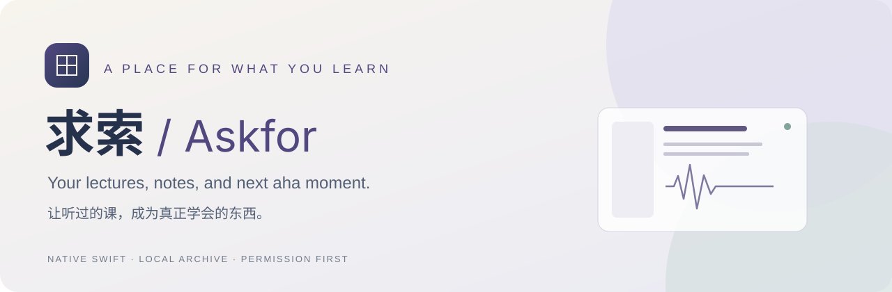
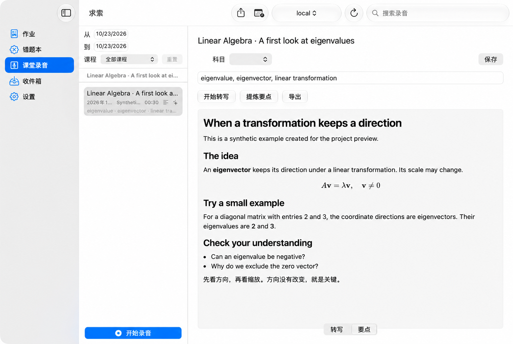

<p align="center">
  
</p>
<p align="center">
  <a href="README.zh-CN.md">简体中文</a> · <strong>English</strong> · <a href="docs/RESPONSIBLE_USE.md">Responsible use</a> · <a href="docs/PRIVACY.md">Privacy</a>
</p>
<p align="center">
  
  
  <a href="LICENSE"></a>
  
</p>

## Make room for the next aha moment

A lecture ends. The hard part is turning what you heard into something you can return to.

**Askfor (求索)** is a native Mac study archive for authorized recordings, transcripts, homework, and mistakes worth revisiting. It brings those pieces together in a small Swift app: record or import, transcribe with Apple's on-device speech tools, organize by course, and optionally ask a model you configure to help make sense of the text.

Built from a personal learning workflow. Shared as an early, build-it-yourself source release.
The current app interface is primarily Chinese; the project documentation is bilingual.

> **Permission comes first.** A microphone permission dialog grants device access; it does not grant permission to record a class. Obtain the required authorization before recording, and separately check whether AI processing or sharing is allowed. Askfor has no university affiliation or compliance certification.

## What it does

| From… | To… |
| :--- | :--- |
| A recording you are authorized to make or use | A local recording and searchable transcript |
| A transcript full of details | Optional AI study notes, with the destination disclosed before sending |
| Loose scans, PDFs, and notes | A watched inbox and linked study archive |
| An answer you got wrong | A mistake entry, OCR text, and optional explanation |
| A course schedule | Optional calendar matching for recordings |
| Notes you want to keep | Markdown exports and rendered mathematical notation |

**Native SwiftUI.** One process, five Swift libraries, SQLite storage. No Electron or Python runtime required by the app.

**Local archive, optional AI.** Recording, storage, OCR, and supported speech transcription run on the Mac. AI summaries use a separately configured OpenAI-compatible endpoint. A local gateway may forward requests elsewhere; check its configuration.

**Visible choices.** Each recording session asks for authorization. AI analysis and exports have separate confirmations. Opening the recordings page does not activate the microphone. Summarizing does not delete the original recording or transcript.

## Preview



A real app screenshot with synthetic notes and a silent generated fixture. No classroom audio or student data is shown.

## Build and run

Requirements:

- An Apple Silicon Mac running **macOS 15 or later**.
- **Full Xcode**, selected as the active developer directory. A current SDK with SpeechAnalyzer and FoundationModels is required; the release is checked with Xcode 27. Command Line Tools alone are insufficient.
- On-device speech support and the relevant language assets. macOS 26+ uses `SpeechAnalyzer`; older supported systems use the on-device `SFSpeechRecognizer` path when available.

```sh
git clone https://github.com/zhuzccn-rgb/qiusuo.git
cd qiusuo
./scripts/make-app.sh
open dist/求索.app
```

Or open `Lexicon.xcodeproj` in Xcode and choose the **求索** scheme.

The script builds with the installed macOS SDK and creates an **ad-hoc signed** local app. This release does not include a notarized download or App Store package. Older supported OS versions and Intel Macs have not been verified in this release.

## Your first study session

1. Open **课堂录音**. For a new recording, obtain the required permission first, then confirm it in the app. Or import audio you are authorized to use.
2. Stop and save, then transcribe. Speech assets may need an initial download.
3. Edit the course/title or enable calendar access if you want schedule matching.
4. Optionally configure an AI endpoint, review what will be sent, and request study notes.
5. Review the result against your source. Export only when the material's permissions allow it.

For iPad work, AirDrop the files to your Mac, then place the intended files in `~/Downloads/LexiconInbox/` or choose them explicitly in the app. Keep third-party course material out of public repositories.

## Optional model connection

Askfor does not bundle model weights or require a paid AI service. It speaks the OpenAI-compatible `/v1/models` and `/v1/chat/completions` protocols. Presets cover llama.cpp, LM Studio, Ollama, and agent gateways; server-specific compatibility can vary.

| Setting | Example |
| :--- | :--- |
| Base URL | `http://127.0.0.1:8080/v1` |
| Model | The identifier exposed by your server |
| API key | Enter only if your server requires one; retained for the current session only |

Use **HTTPS** for non-loopback endpoints. For another computer, use authenticated HTTPS or an encrypted tunnel exposed on loopback. Plain HTTP is accepted only for `localhost`, `127.0.0.1`, or `::1`.

Model discovery and connection tests are manual. A summary sends the transcript and limited course metadata as text; mistake analysis sends the entered question and answer fields. Raw audio and local file paths are not included in those prompts. See [Privacy & data flow](docs/PRIVACY.md) for the full boundary, including external agent tools and storage limitations.

## Inside the app

```text
App / SwiftUI
 ├─ LexiconCore      SQLite archive · search · Markdown/LaTeX rendering helpers
 ├─ LexiconSpeech    microphone capture · on-device speech · audio utilities
 ├─ LexiconInbox     inbox watching · PDF/image OCR · file imports
 ├─ LexiconCalendar  optional EventKit course matching
 └─ LexiconLLM       OpenAI-compatible HTTP client · study prompts
```

Default data locations:

```text
~/Library/Application Support/Lexicon/archive.sqlite
~/Library/Application Support/Lexicon/recordings/
~/Downloads/LexiconInbox/
```

The archive is **not application-encrypted**. Imported documents are generally referenced by path; imported audio can be copied into the recordings directory. Moving source documents can break those references. Use a trusted device and your own backup policy.

## Development

```sh
swift test
python3 scripts/check-release.py
```

Tests use synthetic fixtures. Live microphone capture is skipped unless explicitly enabled with `QIUSUO_LIVE_MIC_TESTS=1`; it records real ambient audio, so enable it only in an appropriate setting with permission. No test should play audio through speakers.

For an isolated walkthrough that does not open your existing archive or Downloads:

```sh
QIUSUO_DATA_DIRECTORY=/tmp/qiusuo-demo dist/求索.app/Contents/MacOS/求索
```

See [CONTRIBUTING.md](CONTRIBUTING.md), [AGENTS.md](AGENTS.md), and the [release verification notes](docs/RELEASE_NOTES.md). Please use synthetic or explicitly licensed examples in issues and pull requests.

## License & acknowledgments

Askfor's original code and documentation are available under the [MIT License](LICENSE).
The bundled MathJax 3.2.2 renderer keeps its [Apache 2.0 license](third_party/MathJax/LICENSE); see [third-party notices](THIRD_PARTY_NOTICES.md).

**The software license covers the software.** It does not license recordings, voices, slides, transcripts, or other content you put into it. [Responsible use / 使用边界 →](docs/RESPONSIBLE_USE.md)
